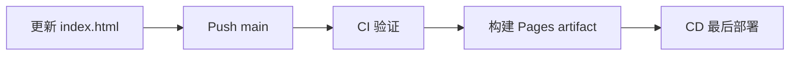

# AI Daily Brief

一份面向 AI builders 的中文每日技术简报，关注真正影响开发实践的新模型、Agent/Coding Agent、AI engineering、开源项目、评测与安全动态。

[](https://github.com/Mira190/ai-daily-brief/actions/workflows/pages.yml)
[](https://mira190.github.io/ai-daily-brief/)

## 在线阅读

最新版本：

<https://mira190.github.io/ai-daily-brief/>

## 内容方法

简报采用以下流程：

1. 以 `Australia/Sydney` 时区的过去 24 小时为主窗口，并保留滚动 7 天热点追踪。
2. 宽扫实验室与作者博客、Hacker News、GitHub、Hugging Face、arXiv、Product Hunt、公开社交讨论和高质量技术博客。
3. 对陌生且快速升温的名词、论文、架构和项目进行二次检索。
4. 回到原始公告、论文、仓库或作者原文反向核查。
5. 按“事件增量”与最近 7 天归档去重，不用没有新进展的旧闻补数。
6. 对技术实质、传播速度、开发者影响和证据成熟度分别判断。

## 宽扫候选采集

第 2 步的一部分由 `scan` 自动完成：抓取过去 24 小时（Australia/Sydney）的候选条目，并对照已发布的 `index.html` 标出往期引用过的链接，供第 5 步去重。

```bash
uv sync
uv run python -m scan                      # 写入 scan-output/<日期>.md 和 .json
uv run python -m scan --sources hn,hf --hours 48
uv run python -m unittest discover -s tests
```

| 来源 | 内容 | 筛选 |
|---|---|---|
| `hn` | Hacker News（Algolia API） | ≥ 30 points，标题含 AI 相关词（整词匹配） |
| `hf` | Hugging Face 每日论文 | 按 upvotes 取前 15，arXiv 与 HF 论文链接视为同一篇 |
| `github` | 近 7 天新建的 `llm` / `ai-agents` / `mcp` 主题仓库 | ≥ 50 stars，没有描述的仓库丢弃（多为垃圾或钓鱼仓库） |
| `rss` | Hugging Face、OpenAI、Google DeepMind、Simon Willison 博客；Anthropic News | 窗口内发布；没有发布时间的条目丢弃，不当作新闻。Anthropic 没有 RSS，用 sitemap 的 lastmod 发现新文章（robots.txt 允许），编辑过的旧文也会出现，摘要标为 `(sitemap lastmod: new or edited)` |
| `reddit` | r/LocalLLaMA、r/MachineLearning、r/ClaudeAI、r/ChatGPT 当日热门 | 只走官方 Data API，需要配置凭据（见下）；每版前 5 条 |

输出是候选清单，不是简报：每条仍要走第 3–4 步回到原始来源核实。某个来源抓取失败时，结果开头会列出「未覆盖的来源」，这些渠道需要手动补扫，不能当作当天没有新闻。设置 `GITHUB_TOKEN` 环境变量可提高 GitHub API 限额（只用于请求头，不会写入输出）。

Reddit 的 robots.txt 禁止一切匿名抓取（`User-agent: * / Disallow: /`），官方要求程序访问走 Data API，所以 `reddit` 只用 OAuth：在 <https://www.reddit.com/prefs/apps> 建一个 script 类型的应用，然后设置环境变量 `REDDIT_CLIENT_ID`、`REDDIT_CLIENT_SECRET` 和 `REDDIT_USERNAME`（用于 Reddit 要求的 User-Agent）。没有配置时，这个来源会列为「未覆盖」，不会退回匿名抓取。请求仍按响应头 `x-ratelimit-*` 限速。每个版块的结果缓存 3 小时（`scan-output/.cache/`）。单次等待超过 90 秒，或本次运行累计等待超过 5 分钟时，剩下的版块留到下次运行。

Glassdoor、一亩三分地、Blind、LeetCode Discuss 等站点的条款禁止自动抓取，不作为来源。

`scan-output/` 已加入 `.gitignore`：采集结果属于研究缓存，按 [SECURITY.md](SECURITY.md) 不进入公开仓库。

## 站点功能

- 按年份和月份折叠浏览历史简报
- 日期切换与当前简报搜索
- 暗色模式
- 移动端布局
- 打印友好样式
- 单文件静态站点，无后端、无追踪脚本

## 自动发布

每日简报生成并通过结构、来源与隐私检查后，更新根目录的 `index.html`。任何包含 `index.html` 更新并进入 `main` 的提交，都会自动触发 GitHub Actions：

1. Checkout 当前 `main` snapshot。
2. 验证 HTML 完整性、日期/article 映射、内嵌 JavaScript 语法与公开内容隐私规则。
3. 配置并启用 GitHub Pages。
4. 将通过验证的静态文件打包为 Pages artifact。
5. 最后才部署到固定站点地址；任何前置步骤失败都会阻止发布。

不需要服务器、数据库、部署密钥或人工上传。也可以在仓库的 **Actions → Deploy AI Daily Brief → Run workflow** 手动重跑部署。



发布遵循 fail-safe 原则：生成、归档或检查失败时不推送；部署失败时保留上一版可用站点。

### 部署入口

- 线上站点：<https://mira190.github.io/ai-daily-brief/>
- Workflow：<https://github.com/Mira190/ai-daily-brief/actions/workflows/pages.yml>
- 部署配置：[`.github/workflows/pages.yml`](.github/workflows/pages.yml)

## 仓库结构

```text
.
├── index.html                  # 完整简报归档与交互界面
├── README.md                   # 项目说明
├── SECURITY.md                 # 安全与隐私政策
├── scan/                       # 宽扫候选采集（python -m scan）
├── tests/                      # scan 的离线单元测试
├── pyproject.toml / uv.lock    # Python 依赖
├── .nojekyll                   # 禁用 Jekyll 转换
└── .github/workflows/pages.yml # GitHub Pages 部署
```

## 安全与隐私

本仓库只包含公开来源的简报正文和静态界面。“相关性”分析面向通用 AI Engineer，不使用具体读者的雇主、项目、教育经历或个人工作流。本仓库不应提交 API key、访问令牌、内部文件标识、用户账号信息、本地绝对路径、研究缓存或其他 PII。详情见 [SECURITY.md](SECURITY.md)。

## 信息边界

简报是技术信息筛选与分析，不构成投资、法律、医疗或安全授权建议。厂商 benchmark、作者声明、早期论文与独立复现会尽量明确区分。
